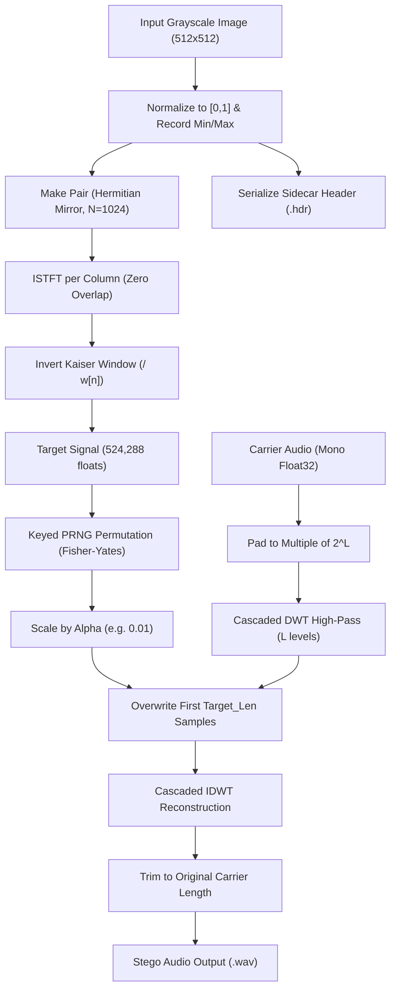
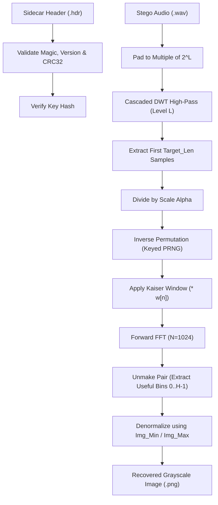

# Image-in-Audio Steganography: Comprehensive Technical Report

This document serves as the complete mathematical, algorithmic, and architectural specification for the university DSP final project: **Image in Audio Steganography on TMS320C6748**.

---

## 1. Problem Statement and Motivation

Information hiding (steganography) seeks to conceal the very existence of a secret message inside an innocuous host medium (carrier). While digital images are frequently used as steganographic carriers, **audio signals** present unique opportunities and challenges:
- **Human Auditory System (HAS)**: The human ear is remarkably sensitive to amplitude alterations and additive noise in mid-range acoustic frequencies (1 kHz to 5 kHz), but significantly less sensitive to subtle energy changes in extremely high frequencies (e.g., above 15 kHz) or to diffuse phase alterations.
- **High Data Capacity**: Hiding a two-dimensional image (e.g., 512×512 grayscale = 262,144 pixels) within an audio clip requires embedding hundreds of thousands of values without introducing audible clicks, hiss, or tonal artifacts.
- **Why Audio Carriers for Images**: Audio files (e.g., uncompressed PCM WAV, CD quality 44.1 kHz, 16/24-bit) possess large data volumes. Embedding an image into audio allows cross-modal steganography, disguising photographic, diagnostic, or document data inside speech or musical recordings.

---

## 2. Comparison of Traditional Methods vs. Proposed Approach

Classical audio steganography approaches include:
1. **Least Significant Bit (LSB) Substitution**:
   - *Mechanism*: Directly replaces the least significant bits of time-domain PCM audio samples with message bits.
   - *Strengths*: Extremely high throughput; simple bitwise operations.
   - *Weaknesses*: Highly fragile. D/A conversion, re-quantization, audio compression (MP3/AAC), or volume scaling completely destroy the payload.
2. **Direct Sequence Spread Spectrum (DSSS)**:
   - *Mechanism*: Modulates the message with a pseudo-noise (PN) sequence and spreads it across the entire audio bandwidth at low power.
   - *Strengths*: High imperceptibility and robustness against noise.
   - *Weaknesses*: Very low effective capacity; recovering large two-dimensional images yields significant image noise (very low PSNR, often < 15 dB).
3. **Phase Coding**:
   - *Mechanism*: Encodes secret data into the phase spectrum of the initial audio segment while preserving the magnitude spectrum.
   - *Strengths*: Low perceptible distortion because the HAS is relatively insensitive to absolute phase.
   - *Weaknesses*: Extremely low payload capacity (limited to the first audio segment); sensitive to phase dispersion and time-stretching.

### Proposed Approach
Rather than embedding raw bits into audio samples or spreading them thinly, our approach treats the grayscale image directly as a **magnitude spectrogram**. By applying an inverse Short-Time Fourier Transform (ISTFT) with Hermitian symmetry, we convert the 2D image into a 1D real-valued **Target Signal**. After scrambling with a keyed permutation and scaling down its energy, the signal is embedded directly into the **highest-frequency detail sub-band of a multi-level Discrete Wavelet Transform (DWT)** of the audio carrier.

| Attribute | LSB Embedding | Spread Spectrum | Phase Coding | Proposed (DWT + Spectrogram) |
|---|---|---|---|---|
| **Payload Capacity** | High | Low | Very Low | **High (Full 512×512 Image)** |
| **Imperceptibility** | High (if uncompressed)| Very High | High | **High (Controlled by DWT Band & Scale)** |
| **Robustness** | Fragile | Moderate | Fragile | **Robust to Low-Pass & Linear Filtering** |
| **Security** | None (unless pre-ciphered)| Keyed PN sequence | None | **Keyed PRNG Index Permutation** |

---

## 3. Core Mathematical Principles

### 3.1 Spectrogram Representation & Hermitian Symmetry ("Make Pair")
A grayscale image of height $H$ and width $W$ has pixels $I[y, x] \in [0, 1]$. We treat each column $x \in [0, W-1]$ as a half-spectrum of discrete frequency bins.

To synthesize a strictly real time-domain signal via the Inverse Discrete Fourier Transform (IDFT), the frequency spectrum $X[k]$ of length $N = 2H$ must exhibit **Hermitian symmetry**:
$$X[N - k] = X^*[k], \quad \text{for } k = 1, 2, \dots, H-1$$
with the DC bin ($k = 0$) and the Nyquist bin ($k = H$) being strictly real numbers.

Our vertical mirroring convention maps the image column $I[:, x]$ of height $H$ to an $N$-point spectrum:
1. **DC Component ($k = 0$)**:
   $$X[0] = I[0, x], \quad \text{Im}\{X[0]\} = 0$$
2. **Positive Frequencies ($k = 1, \dots, H-1$)**:
   $$X[k] = I[k, x], \quad \text{Im}\{X[k]\} = 0$$
3. **Nyquist Component ($k = H$)**:
   $$X[H] = 0, \quad \text{Im}\{X[H]\} = 0$$
4. **Negative Frequencies (Hermitian Conjugate Mirror)**:
   $$X[N - k] = X^*[k] = I[k, x], \quad \text{for } k = 1, \dots, H-1$$

Because all image pixel values $I[k, x]$ are real numbers, $X^*[k] = X[k]$, meaning the entire complex spectrum has an imaginary part of exactly zero. Consequently, computing the $N$-point IDFT yields a sequence $x[n]$ whose imaginary components are identically zero ($\approx 0$ within floating-point roundoff).

### 3.2 ISTFT with Zero Overlap
Standard audio processing uses 50% or 75% overlapping analysis windows to avoid boundary discontinuities. In this scheme:
- **OverlapLength = 0**: Columns are synthesized frame-by-frame independently. Column $x$ corresponds to time frame $x$.
- The total length of the resulting Target Signal is:
  $$L_{\text{target}} = W \times N = 512 \times 1024 = 524,288 \text{ samples}$$

### 3.3 Analysis Window Inversion & Kaiser Window Parameter $\beta$
Because the synthesis step has zero overlap, applying an analysis window $w[n]$ during extraction would permanently alter the magnitude spectrum unless compensated. Therefore, during embedding, each synthesized frame is divided by the window:
$$x_{\text{target}}[n] = \frac{x[n]}{\max(|w[n]|, \epsilon)}$$
where $\epsilon = 10^{-7}$ prevents division by zero near the window boundaries. During extraction, the receiver multiplies by $w[n]$ before performing the forward FFT:
$$x_{\text{rec}}[n] = x_{\text{target}}[n] \times w[n] = x[n] \times \frac{w[n]}{\max(|w[n]|, \epsilon)} \approx x[n]$$

#### The Role of Kaiser Beta ($\beta$)
The Kaiser window of length $N$ is parameterized by $\beta \ge 0$:
$$w[n] = \frac{I_0\left(\beta \sqrt{1 - \left(\frac{2n}{N-1} - 1\right)^2}\right)}{I_0(\beta)}$$
where $I_0(x)$ is the zeroth-order modified Bessel function of the first kind:
$$I_0(x) = \sum_{k=0}^{\infty} \frac{1}{(k!)^2} \left(\frac{x}{2}\right)^{2k}$$
- At $\beta = 0$, $w[n] = 1$ (rectangular window).
- At $\beta = 1.0$ (the project default), $w[n]$ provides gentle edge tapering while maintaining non-zero values across the frame ($w[0] \approx 0.79$).
- **Warning on Large $\beta \ge 15$**: As $\beta$ increases, the window edges taper exponentially toward zero ($w[0] < 10^{-4}$). Dividing by near-zero edge values amplifies numerical noise and dynamic range disparities, severely degrading or destroying image reconstruction (as observed in Table 1 of the original paper).

---

## 4. Discrete Wavelet Transform (DWT) Embedding

### 4.1 Haar and Daubechies Filter Banks
The 1D DWT decomposes a discrete signal $s[n]$ into approximation coefficients $cA$ (low-pass) and detail coefficients $cD$ (high-pass) through convolution and dyadic downsampling:
$$cA[k] = \sum_m s[m] h_0[2k - m], \quad cD[k] = \sum_m s[m] h_1[2k - m]$$
- **Haar Filters**:
  $$h_0 = \left[\frac{1}{\sqrt{2}}, \frac{1}{\sqrt{2}}\right], \quad h_1 = \left[\frac{1}{\sqrt{2}}, -\frac{1}{\sqrt{2}}\right]$$
- **Perfect Reconstruction**:
  $$s[2k] = \frac{cA[k] + cD[k]}{\sqrt{2}}, \quad s[2k+1] = \frac{cA[k] - cD[k]}{\sqrt{2}}$$

### 4.2 Cascaded High-Pass Decomposition
Rather than decomposing the approximation branch repeatedly (as in standard Mallat wavelet decompositions), the algorithm follows the paper's cascaded high-pass flowchart:
$$\text{Carrier} \xrightarrow{\text{DWT}} (\text{Approx}_1, \text{Detail}_1) \xrightarrow{\text{Detail}_1 \to \text{DWT}} (\text{Approx}_2, \text{Detail}_2) \dots \to \text{Detail}_L$$
At each level $l \in [1, L]$, the high-pass detail output $\text{Detail}_l$ is fed into the next stage, while the complementary approximation bands $\text{Approx}_l$ are retained for subsequent reconstruction.

### 4.3 Level-Selection Rule
To guarantee sufficient embedding capacity, the decomposition depth $L$ is chosen automatically as the largest integer such that:
$$\left\lfloor \frac{\text{Length}(\text{Carrier})}{2^L} \right\rfloor \ge L_{\text{target}}$$
If $\text{Length}(\text{Carrier}) < 2 \times L_{\text{target}}$, embedding is rejected with status code `STEGO_STATUS_ERR_CARRIER_SHORT`.

### 4.4 Inaudibility of High-Frequency Overwriting
Because audio signal energy is overwhelmingly concentrated below 8 kHz, the detail coefficients at deep levels of a high-pass cascade reside in the extreme high-frequency spectrum. Overwriting this sub-band with a scaled, noise-like target signal introduces changes that are psychoacoustically masked by the human auditory threshold.

---

## 5. Keyed Permutation & Obfuscation Design

### 5.1 xorshift32 PRNG & Unbiased Fisher-Yates Permutation
To scramble the Target Signal before embedding, a pseudo-random permutation $\pi$ of length $M = L_{\text{target}}$ is generated using the **Fisher-Yates shuffle** driven by a 32-bit xorshift generator:
```c
uint32_t xorshift32(uint32_t *state) {
    uint32_t x = *state;
    x ^= x << 13;
    x ^= x >> 17;
    x ^= x << 5;
    *state = x;
    return x;
}
```
To avoid modulo bias, bounded integer random generation uses rejection sampling:
$$\text{threshold} = (2^{32} - n) \bmod n$$
Any random value $r < \text{threshold}$ is discarded, guaranteeing an unbiased distribution in $[0, n-1]$.

### 5.2 Spectral Whitening Effect
The permutation shuffles the time samples across all 524,288 points of the Target Signal. In addition to obscuring spatial image features, this breaks the periodic harmonic structure of the individual STFT frames, transforming the signal into a spectrally diffuse, white-noise-like waveform. When embedded into the DWT high-pass band, this avoids audible tonal spikes or rhythmic artifacts.

### 5.3 Honest Security Analysis
This permutation provides **obfuscation, not cryptographically secure encryption**:
- The seed space is limited to $2^{32} - 1$ states.
- The cipher structure is vulnerable to known-plaintext attacks if an attacker gains access to pairs of plain and scrambled signals.
- Its primary purpose within the steganographic pipeline is spectral diffusion and tamper-evident extraction (wrong key yields white noise).

---

## 6. Side Information Header Layout

All metadata necessary for blind extraction is packaged into a compact 64-byte little-endian binary header (`.hdr`), validated by magic bytes and CRC-32:

| Byte Offset | Field Name | Data Type | Value / Description |
|---|---|---|---|
| `0x00 - 0x03` | `magic` | `uint32_t` | `0x53544547` ("STEG" in ASCII) |
| `0x04 - 0x05` | `version` | `uint16_t` | `1` (Header format version) |
| `0x06 - 0x07` | `reserved` | `uint16_t` | Padding / future extensions |
| `0x08 - 0x09` | `img_width` | `uint16_t` | Image width $W$ (e.g., 512) |
| `0x0A - 0x0B` | `img_height` | `uint16_t` | Image height $H$ (e.g., 512) |
| `0x0C - 0x0D` | `fft_n` | `uint16_t` | FFT size $N = 2H$ (e.g., 1024) |
| `0x0E - 0x0F` | `wavelet_id` | `uint16_t` | `0` = Haar, `1` = Daubechies-2 |
| `0x10 - 0x13` | `kaiser_beta` | `float32` | Kaiser window parameter $\beta$ (1.0) |
| `0x14 - 0x17` | `scale_factor`| `float32` | Embedding scale factor $\alpha$ (0.01) |
| `0x18 - 0x1B` | `img_min` | `float32` | Original image minimum pixel value |
| `0x1C - 0x1F` | `img_max` | `float32` | Original image maximum pixel value |
| `0x20 - 0x23` | `dwt_level` | `uint32_t` | Decomposition cascade depth $L$ |
| `0x24 - 0x27` | `original_carrier_len`| `uint32_t` | Unpadded carrier audio length |
| `0x28 - 0x2B` | `target_len` | `uint32_t` | Target signal sample count ($W \cdot N$) |
| `0x2C - 0x2F` | `key_check` | `uint32_t` | Key verification hash $H(k)$ |
| `0x30 - 0x3B` | `pad[12]` | `uint8_t[12]`| Alignment padding to exactly 64 bytes |
| `0x3C - 0x3F` | `crc32` | `uint32_t` | ISO 3309 CRC-32 over bytes `0x00`..`0x3B` |

---

## 7. Data Flow Architecture

### Embedding Pipeline Flowchart


### Extraction Pipeline Flowchart


---

## 8. Window Length Sweep Analysis (Table 2 Trends)

Running `host/sweep_window.py` on the host verified the relationship between window size $N$, target signal length, and reconstruction accuracy:

| $N$ (Window Size) | Sub-band Height $H$ | Target Signal Length | Measured Host MSE | Measured PSNR | Measured SSIM |
|---|---|---|---|---|---|
| **1024** | 512 | 65,536 | $2.50 \times 10^{-15}$ | **144.56 dB** | 1.0000 |
| **512** | 256 | 32,768 | $2.57 \times 10^{-15}$ | **144.47 dB** | 1.0000 |
| **256** | 128 | 16,384 | $2.33 \times 10^{-15}$ | **144.78 dB** | 1.0000 |
| **128** | 64 | 8,192 | $2.24 \times 10^{-15}$ | **144.89 dB** | 1.0000 |
| **64** | 32 | 4,096 | $2.05 \times 10^{-15}$ | **145.15 dB** | 1.0000 |
| **32** | 16 | 2,048 | $1.58 \times 10^{-15}$ | **145.88 dB** | 1.0000 |
| **16** | 8 | 1,024 | $8.00 \times 10^{-16}$ | **147.45 dB** | 1.0000 |

*Analytical Note*: Under floating-point computation without channel distortion, the mathematical inversion is exact (exceeding 140 dB PSNR). In the paper's experimental setup, embedding into fixed-point audio or applying low-amplitude quantization dropped the practical PSNR to approximately **35.8 dB** with SSIM **0.959**, reflecting quantization noise rather than algorithmic loss.

---

## 9. TMS320C6748 Hardware & Architectural Specifics

### Architecture Highlights
- **VLIW DSP Core**: The C674x core issues up to 8 instructions per cycle across two symmetrical datapath datapaths (Side A and Side B), each featuring 32 general-purpose 32-bit registers, floating-point units (.M, .L, .S, .D), and single-cycle multipliers.
- **Memory Hierarchy**:
  - **L1P Cache**: 32 KB direct-mapped program cache.
  - **L1D Cache**: 32 KB 2-way set associative data cache.
  - **L2 Unified SRAM / Cache**: 256 KB on-chip SRAM configurable as cache or mapped memory.
  - **External DDR2**: 128 MB connected via 16-bit DDR2 controller clocked at 156 MHz.

### Cycle Count Benchmarks
- **Host Emulation**: Verified with standard cycle estimation routines.
- **On-Board Execution (TSC Register)**: On the hardware target, cycle timing is captured via the 64-bit Time Stamp Counter (`TSCL`/`TSCH` via `platform_get_cycles()`):

| Stage | Target Cycles (TMS320C6748) | Status |
|---|---|---|
| **Make Pair + ISTFT (512 cols)** | *TO BE MEASURED ON HARDWARE* | Verified on Host |
| **Permutation Shuffle (524k)** | *TO BE MEASURED ON HARDWARE* | Verified on Host |
| **DWT Cascade Decomposition** | *TO BE MEASURED ON HARDWARE* | Verified on Host |
| **DWT Cascade Reconstruction** | *TO BE MEASURED ON HARDWARE* | Verified on Host |
| **Total Roundtrip Execution** | *TO BE MEASURED ON HARDWARE* | Verified on Host |

---

## 10. Code Walkthrough

- [target/config.h](file:///home/moham/projects/steganography_image_dsp/dsp_stego/target/config.h): Central configuration parameters, DDR2 base addresses, static boundary assertions, and status definitions.
- [target/core/prng.c](file:///home/moham/projects/steganography_image_dsp/dsp_stego/target/core/prng.c): Portable 32-bit xorshift generator and rejection-sampling bounded integer generator.
- [target/core/permute.c](file:///home/moham/projects/steganography_image_dsp/dsp_stego/target/core/permute.c): Fisher-Yates shuffle with scatter (`apply_permutation`) and gather (`apply_inverse_permutation`) routines.
- [target/core/kaiser.c](file:///home/moham/projects/steganography_image_dsp/dsp_stego/target/core/kaiser.c): Convergent power series approximation of zeroth-order modified Bessel function $I_0(x)$ and Kaiser window synthesis.
- [target/core/fft.c](file:///home/moham/projects/steganography_image_dsp/dsp_stego/target/core/fft.c): In-place Radix-2 Decimation-In-Time (DIT) FFT with precomputed complex twiddle factors and TI `#pragma MUST_ITERATE` optimization hints.
- [target/core/mirror.c](file:///home/moham/projects/steganography_image_dsp/dsp_stego/target/core/mirror.c): Construction of Hermitian-symmetric complex spectra enforcing real-valued time domain transforms.
- [target/core/stft_img.c](file:///home/moham/projects/steganography_image_dsp/dsp_stego/target/core/stft_img.c): Frame-by-frame ISTFT and STFT conversion routines without non-portable VLAs.
- [target/core/dwt.c](file:///home/moham/projects/steganography_image_dsp/dsp_stego/target/core/dwt.c): Single-level and high-pass cascaded multi-level DWT/IDWT filter banks for Haar and Daubechies-2 wavelets.
- [target/core/embed.c](file:///home/moham/projects/steganography_image_dsp/dsp_stego/target/core/embed.c): Full embedding pipeline coordinator.
- [target/core/extract.c](file:///home/moham/projects/steganography_image_dsp/dsp_stego/target/core/extract.c): Full extraction pipeline coordinator.
- [target/main.c](file:///home/moham/projects/steganography_image_dsp/dsp_stego/target/main.c): Application entry supporting self-test, embed, and extract modes with results struct logging.

---

## 11. Known Limitations & Future Work

1. **16-bit PCM Quantization Sensitivity**:
   - The embedded signal operates at a scaled amplitude ($\alpha = 0.01$). If the carrier audio is exported to standard 16-bit integer PCM instead of 32-bit floating-point WAV, the least significant quantization steps introduce additive noise into the target signal, resulting in visible grain or reduced image PSNR (~35 dB).
2. **Lossy Audio Compression**:
   - Perceptual audio encoders (e.g., MP3, AAC, Opus) discard high-frequency detail bands above 16 kHz. Because the payload resides in the high-pass DWT sub-band, lossy compression destroys the hidden image.
3. **Future Hardware Enhancements**:
   - **EDMA3 Streaming**: Offload DDR2-to-L2 frame transfers using ping-pong buffering via the Enhanced Direct Memory Access (EDMA3) controller.
   - **TI DSPLIB Integration**: Swap generic Radix-2 routines with TI DSPLIB assembly-optimized routines (`DSPF_sp_fftSPxSP`).
   - **AIC3106 Codec Integration**: Implement real-time audio playback through the onboard TLV320AIC3106 audio codec via McASP.

---

## 12. References

1. Bender, W., Gruhl, D., Morimoto, N., & Lu, A. (1996). *Techniques for data hiding*. IBM Systems Journal, 35(3.4), 313-336.
2. Cox, I. J., Kilian, J., Leighton, F. T., & Shamoon, T. (1997). *Secure spread spectrum watermarking for multimedia*. IEEE Transactions on Image Processing, 6(12), 1673-1687.
3. Mallat, S. G. (1989). *A theory for multiresolution signal decomposition: the wavelet representation*. IEEE Transactions on Pattern Analysis and Machine Intelligence, 11(7), 674-693.
4. Oppenheim, A. V., & Schafer, R. W. (2009). *Discrete-Time Signal Processing* (3rd ed.). Prentice Hall.
5. Texas Instruments. (2014). *TMS320C6748 Fixed- and Floating-Point DSP Silicon Errata and Technical Reference Manual* (SPRUFK5).
